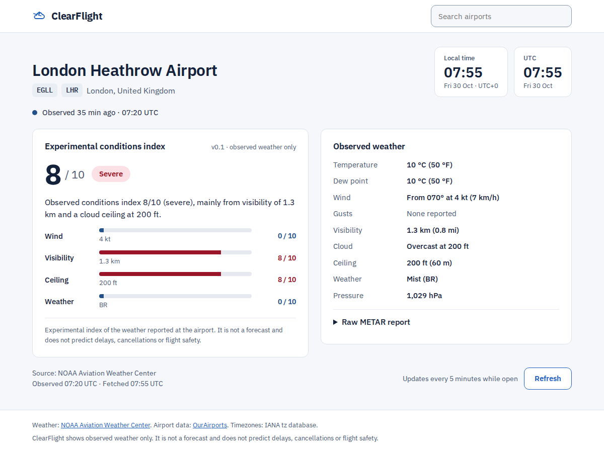
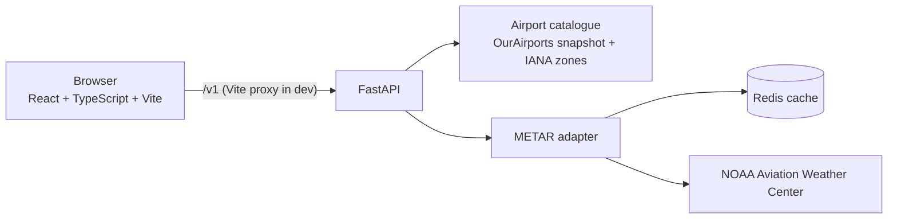
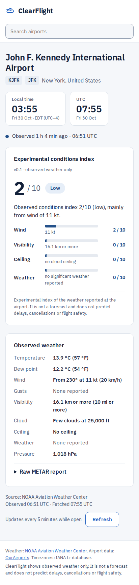

# ClearFlight

**Airport weather, explained.** ClearFlight shows travellers the latest *observed* weather at an airport, how recent it is, and an experimental 0–10 conditions index with the reasons behind it. Search any of about 11,000 airports by name, city or code, then open a shareable page such as `/airport/EGLL`.



ClearFlight shows observed weather only. It is not a forecast, an aviation briefing or a flight tracker, and its index does not predict delays, cancellations or flight safety.

## Status
Under active development and **not publicly deployed**: public deployment waits until the app includes flight data and fuller predictive scoring (owner decision, 2026-11-07). The whole app runs locally with Docker.

| | |
|---|---|
| Done | Airport catalogue and search (CF-002) · METAR weather adapter (CF-003) · conditions API and index v0.1 (CF-004) · web app (CF-005) |
| Next | Phase 2 ([plan v1.1](docs/development-plan.md)): forecast outlook, live aircraft and airport map, observed movements, disruption signals, flight lookup |
| Deferred | Public deployment (CF-006) and traveller validation (CF-007), until that phase is built |

**Known limitations:**
- The index bands are heuristic (v0.1) and not yet validated with travellers.
- Weather comes from METAR reports, so airports without a reporting station show "unavailable".
- The provider request budget is per server process.
- A garbled report whose wind, visibility and cloud fields still parse is scored normally.
- A provider timeout can make a lookup take up to about 21 s.

## Quick start
You need Docker.

```bash
git clone https://github.com/Yoyo-su/ClearFlight-API.git
cd ClearFlight-API
cp .env.template .env      # dummy values are fine; see below
docker compose up --build
```

- **Web app:** http://localhost:5173. The first start installs its packages, which takes a minute.
- **API:** http://localhost:8000; `/health` should return `{"status": "ok"}`, and interactive docs are at http://localhost:8000/docs.
- **Stop:** `docker compose down`.

The weather and airport data need **no API keys**. The `.env` keys (`AVIATIONSTACK_API_KEY`, `WEATHERSTACK_API_KEY`) are only used by the deprecated `/airport/{code}` route, which is due to be removed. Dummy or empty values work otherwise. Keep `.env` private and never commit real keys. Everything binds to `127.0.0.1` only, and Redis stays on Docker's internal network.

> On Linux/WSL, Docker may leave an empty, root-owned `frontend/node_modules` folder on a fresh clone. If a host `npm ci` then fails, remove it with `sudo rm -rf frontend/node_modules`.

## How it works



- **Airport catalogue:** a committed snapshot of OurAirports data with each airport's IANA timezone precomputed (`app/data/airports.csv`). It's searched in memory, and airports with scheduled airline service rank higher.
- **Weather:** the latest METAR report for the airport's station, normalised with honest missing values. It's cached in Redis, retried once on failure, and capped per minute to protect the free provider.
- **Conditions index v0.1:** the highest of four factor scores (wind, visibility, cloud ceiling, reported weather). It's given only for a current report with every input known; otherwise it's "unknown". The one exception: if the known factors already reach 10 (for example, dense fog with the cloud height not reported), the score is 10. Each factor and a one-sentence explanation are shown.
- **Freshness:** reports up to 90 minutes old are current, up to 180 minutes are shown but not scored, and older ones are withheld. The page applies these limits as time passes, even if refreshes fail.

| Layer | Stack |
|---|---|
| Frontend | React 19, TypeScript 6, Vite 8, react-router; Vitest + Testing Library; Playwright + axe |
| Backend | Python 3.13, FastAPI, Pydantic, Redis; pytest |
| Delivery | Docker Compose; GitHub Actions (Python checks, frontend checks, Docker build; tag-gated image publishing) |

More detail: [architecture](docs/ARCHITECTURE.md) · [API reference](docs/API.md) · [decisions](docs/DECISIONS.md).

## Using the app
- **Search** by airport name, city, or IATA/ICAO code. Results appear as you type, and Enter opens the first one. The home page also offers recently viewed airports (remembered in your browser only) and the three pilot airports.
- **Airport page:**
  - local and UTC clocks;
  - the observed weather in metric and imperial units;
  - the report's age and source;
  - the conditions index with its factors;
  - the raw METAR report.
  
  It refreshes every 5 minutes while open; the Refresh button can be used once a minute.
- **Honest states:** stale reports, missing reports, airports without a weather station, invalid codes and provider outages each have their own clear message. Missing data never shows as a reassuring score.



## API
Three routes, documented in full in [docs/API.md](docs/API.md):

| Route | Returns |
|---|---|
| `GET /v1/airports/search?q=…` | Matching airports with codes, place and timezone |
| `GET /v1/airports/{code}/conditions` | Airport, latest observation, conditions index, freshness and eligibility times |
| `GET /health` | `{"status": "ok"}` |

## Development
- **Checks:** `make run-checks` (Python) and `make frontend-checks` (frontend) run the same checks as CI. Both enforce an 80% coverage gate and a dependency audit.
- **Frontend:** in `frontend/`; `npm run dev`, `npm test`, `npm run e2e`.
- **Contract:** the frontend's types come from a runtime schema, and recorded API responses are checked against both that schema and the backend models, so the two sides can't drift silently.
- **More:** setup details, the contract fixtures, the METAR adapter and refreshing the airport data are in [docs/DEVELOPMENT.md](docs/DEVELOPMENT.md).

**CI** (`.github/workflows/CF_deploy.yaml`) runs on pull requests into `main` and pushes to `main` and `pilot/**`: Python checks, frontend checks, then a Docker build (not published). **Releases** (`release.yaml`) publish the Docker image only for `v*` tags, through the gated `release` environment.

## Data sources
- **Airports:** [OurAirports](https://ourairports.com/data/) (public domain).
- **Timezones:**
  - boundaries via [timezonefinder](https://github.com/jannikmi/timezonefinder) (MIT) and [timezone-boundary-builder](https://github.com/evansiroky/timezone-boundary-builder) (ODbL);
  - rules from the [IANA tz database](https://www.iana.org/time-zones).
- **Weather:** METAR observations from the [NOAA Aviation Weather Center](https://aviationweather.gov/) (US government data).

## Docs
| Document | What's in it |
|---|---|
| [docs/API.md](docs/API.md) | Endpoint reference, response fields, index bands, errors |
| [docs/ARCHITECTURE.md](docs/ARCHITECTURE.md) | Current structure versus the planned pilot architecture |
| [docs/DECISIONS.md](docs/DECISIONS.md) | Decision log (D-001 onwards) |
| [docs/DEVELOPMENT.md](docs/DEVELOPMENT.md) | Checks, contract fixtures, METAR adapter, data refresh |
| [docs/development-plan.md](docs/development-plan.md) | Pilot plan: scope, roadmap, acceptance gates |
| [docs/cf-005-design.md](docs/cf-005-design.md) | Frontend design spec |
| [docs/CURRENT_MILESTONE.md](docs/CURRENT_MILESTONE.md) | What's in progress now |

## Roadmap
- **Phase 2 ([plan v1.1](docs/development-plan.md), free data only):** a forecast outlook from official airport forecasts (CF-008), live aircraft positions (CF-009) on an airport map (CF-010), observed departures and arrivals (CF-011), heuristic disruption signals (CF-012), and a flight lookup with best-effort delays (CF-013). Complete per-flight delays and delay prediction aren't possible on free data and stay out of scope.
- **Deferred until then:**
  - CF-006 public deployment: hosting, HTTPS, CORS, request limits, monitoring; release `v0.1.0`; remove the deprecated legacy route;
  - CF-007 traveller validation: 10–20 testers, then a go / iterate / stop decision.
- **Proposed:** a site-wide "popular airports" list; a deeper visual redesign.
